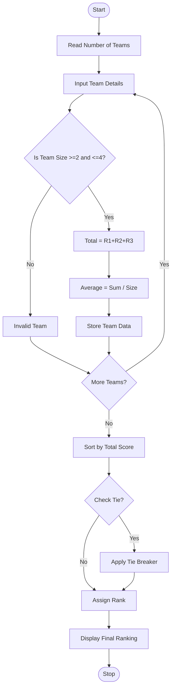

Problem Statement:
52. Hackathon Team Formation and Ranking: Analyse student scores and team compositions, validate team sizes, aggregate round scores and rank teams.

Algorithm:
Step 1: Start
Step 2: Read number of teams
Step 3: For each team, read Team Name, Members, Individual Scores, Round1, Round2, Round3
Step 4: Validate Team Size
Step 5: If Size < 2 or Size > 4 Then Invalid Team, go to next team
Step 6: Calculate Total Score = Round1 + Round2 + Round3
Step 7: Calculate Average Score = Sum of Individual Scores / Team Size
Step 8: Store valid teams in list
Step 9: Sort list by Total Score Descending
Step 10: If Tie, apply rules: Higher Round 3, Higher Average, Alphabetical Name
Step 11: Assign ranks and display result
Step 12: Stop

Flowchart:

