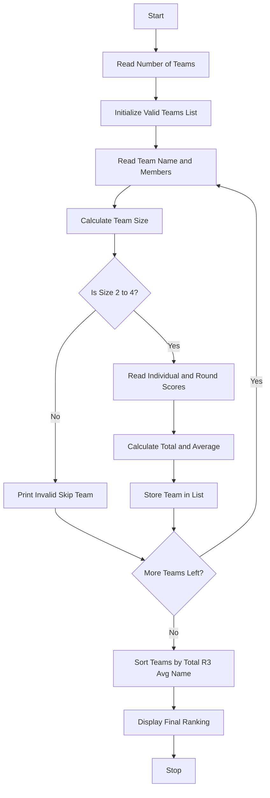

Problem Statement:
Hackathon Team Formation and Ranking System

Develop a system to validate hackathon teams and rank them fairly. Each team must have 2 to 4 members. For each valid team, calculate Total Score from 3 rounds (R1+R2+R3) and Average of individual scores. Ranking Criteria (Tie Breakers): 1. Higher Total Score, 2. Higher Round 3 Score, 3. Higher Average Score, 4. Alphabetical Order of Team Name.

Algorithm:
Step 1: Start
Step 2: Read number of teams n
Step 3: Initialize valid_teams as empty list
Step 4: For i in range n:
         a) Read Team Name and Member Names
         b) Calculate team_size = len(members)
         c) If team_size < 2 or team_size > 4: Print invalid and skip
         d) Read Individual Scores and Round Scores R1 R2 R3
         e) Calculate total = R1+R2+R3
         f) Calculate average = sum(ind_scores)/team_size
         g) Store team data in dictionary and append to valid_teams
Step 5: Sort valid_teams by key = (-total, -R3, -average, name)
Step 6: Display ranking table with Rank, Team Name, Total, R3, Avg, Size
Step 7: Stop

Flowchart:

Sample Input and Output:
Sample Input:
Enter number of teams: 3
--- Team 1 ---
Enter Team Name: CodeCrafters
Enter Member Names: Bhavya, Ram, Sita
Enter Individual Scores for 3 members: 80,85,90
Enter Round1 Round2
