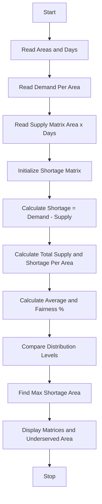

Problem Statement: Water Distribution Fairness Analysis

Analyse area-wise water supply across several days, calculate shortages against demand, compare distribution levels, and identify the most underserved areas.

Algorithm:
1. Start
2. Read number of areas and number of days
3. Read demand per area
4. Read supply matrix area-wise and day-wise
5. Initialize shortage matrix and total supply per area
6. For each area and each day calculate shortage = demand - supply
7. Calculate total supply and total shortage for each area
8. Calculate average supply per area and fairness percentage
9. Compare distribution levels across areas
10. Identify most underserved area with maximum total shortage
11. Display supply matrix, shortage matrix, and underserved areas
12. Stop

Flowchart:

