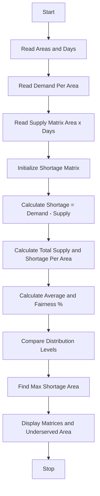

Problem Statement: Water Distribution Fairness Analysis

Analyse area-wise water supply across several days, calculate shortages against demand, compare distribution levels, and identify the most underserved areas.

Algorithm:
1. Start
2. Read number of areas and number of days
3. Read demand per area
4. Read supply matrix area-wise and day-wise
5. Initialize shortage matrix and total supply per area
6. For each area and each day calculate shortage = demand - supply
7. Calculate total supply and total shortage for each area
8. Calculate average supply per area and fairness percentage
9. Compare distribution levels across areas
10. Identify most underserved area with maximum total shortage
11. Display supply matrix, shortage matrix, and underserved areas
12. Stop

Flowchart:

Sample Input:
Enter number of areas: 3
Enter number of days: 3
Enter demand per area: 100 80 120
Area1 supply: 70 80 60
Area2 supply: 80 70 80
Area3 supply: 100 90 80

Sample Output:
Supply Matrix:
Area1: 70 80 60
Area2: 80 70 80
Area3: 100 90 80

Shortage Matrix:
Area1: 30 20 40 | Total Shortage: 90 | Avg Supply: 70
Area2: 0 10 0 | Total Shortage: 10 | Avg Supply: 76.6
Area3: 20 30 40 | Total Shortage: 90 | Avg Supply: 90

Most Underserved Area: Area1 and Area3 with max shortage 90
Fairness %: Area1 70%, Area2 95.8%, Area3 75%
