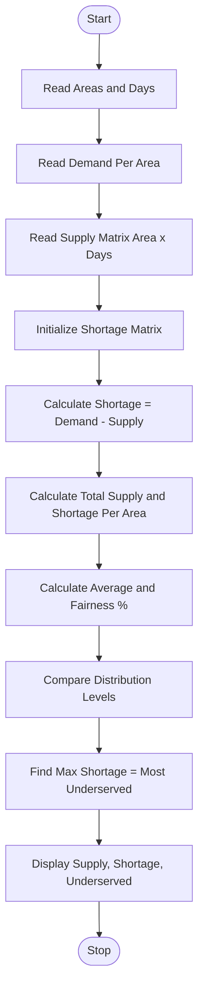

Problem Statement:
Water Distribution Fairness Analysis: Analyse area-wise water supply across several days, calculate shortages against demand, compare distribution levels, and identify the most underserved areas.

Algorithm:
Step 1: Start
Step 2: Read number of areas and number of days
Step 3: Read demand for each area
Step 4: Read supply matrix area-wise and day-wise
Step 5: Initialize shortage matrix and total supply per area
Step 6: For each area and each day calculate shortage = demand - supply
Step 7: Calculate total supply and total shortage for each area
Step 8: Calculate average supply per area and fairness percentage
Step 9: Compare distribution levels across areas
Step 10: Identify most underserved area with maximum total shortage
Step 11: Display supply matrix, shortage matrix, and underserved areas
Step 12: Stop

Flowchart:

