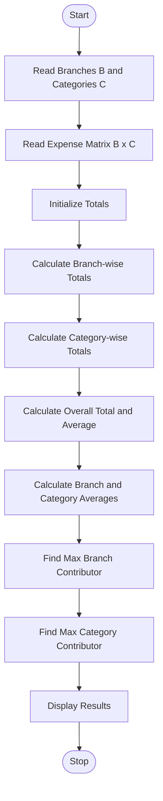

Problem Statement:
Multi-Branch Expense Matrix Analysis: Analyse nested lists containing monthly expenses across branches and categories, calculate totals and averages, and identify the largest contributors to expenditure.

Algorithm:
Step 1: Start
Step 2: Read number of branches (B) and number of categories (C)
Step 3: Read expense matrix [B x C] - monthly expenses for each branch and category
Step 4: Initialize total_expense = 0, branch_totals = [], category_totals = []
Step 5: For each branch i from 0 to B-1, calculate branch_total = sum of expenses[i]
Step 6: For each category j from 0 to C-1, calculate category_total = sum of expenses[i][j] for all branches
Step 7: Calculate overall total = sum of all branch_totals
Step 8: Calculate overall average = total / (B * C)
Step 9: Calculate branch averages and category averages
Step 10: Find branch with maximum total expense - largest branch contributor
Step 11: Find category with maximum total expense - largest category contributor
Step 12: Display totals, averages and largest contributors
Step 13: Stop

Flowchart:

