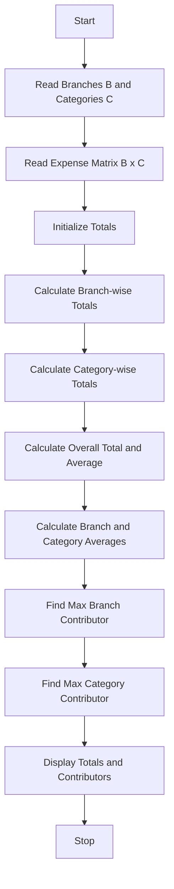

Problem Statement: Multi-Branch Expense Matrix Analysis

Analyse nested lists containing monthly expenses across branches and categories, calculate totals and averages, and identify the largest contributors to expenditure.

Algorithm:
1. Start
2. Read number of branches (B) and number of categories (C)
3. Read expense matrix [B x C] - monthly expenses for each branch and category
4. Initialize total_expense = 0, branch_totals = [], category_totals = []
5. For each branch i from 0 to B-1, calculate branch_total = sum of expenses[i]
6. For each category j from 0 to C-1, calculate category_total = sum of expenses[i][j] for all branches
7. Calculate overall_total = sum of all branch_totals
8. Calculate overall_average = total / (B * C)
9. Calculate branch averages and category averages
10. Find branch with maximum total expense - largest branch contributor
11. Find category with maximum total expense - largest category contributor
12. Display totals, averages and largest contributors
13. Stop

Flowchart:

Sample Input:
Enter number of branches: 3
Enter number of categories: 3
Branch 1 expenses: 1000 2000 1500
Branch 2 expenses: 3000 2500 2000
Branch 3 expenses: 1200 1800 2200

Sample Output:
Branch Totals: Branch1=4500, Branch2=7500, Branch3=5200
Category Totals: Cat1=5200, Cat2=6300, Cat3=5700
Overall Total: 17200
Overall Average: 1911.11
Largest Branch Contributor: Branch2 with 7500
Largest Category Contributor: Category2 with 6300
