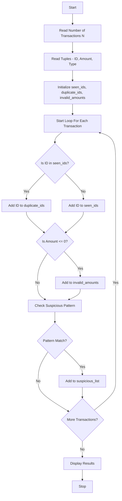

Problem Statement: Tuple-Based Transaction Audit

Process transaction tuples containing identifiers, amounts, and transaction types; detect duplicate identifiers, invalid amounts, and suspicious sequences.

Algorithm:
1. Start
2. Read number of transactions N
3. Read list of transaction tuples containing (Transaction_ID, Amount, Transaction_Type)
4. Initialize empty lists: seen_ids, duplicate_ids, invalid_amounts, suspicious_list
5. For each transaction in list: Extract ID, Amount, Type from tuple
6. If ID is already in seen_ids, add ID to duplicate_ids - Else add ID to seen_ids
7. If Amount is not numeric or Amount <= 0, add to invalid_amounts
8. For suspicious sequence detection: Check if same ID appears more than 3 times consecutively
9. Check if amount exceeds threshold limit (e.g., 100000)
10. Check for rapid credit followed by debit for same ID
11. If any pattern matches, add to suspicious_list
12. Display all duplicate identifiers found
13. Display all invalid amounts found
14. Display all suspicious sequences found
15. Display final audit summary report
16. Stop

Flowchart:

Sample Input:
Enter number of transactions: 5
Transaction 1: ID=101, Amount=5000, Type=credit
Transaction 2: ID=102, Amount=-100, Type=debit
Transaction 3: ID=101, Amount=7000, Type=credit
Transaction 4: ID=103, Amount=150000, Type=credit
Transaction 5: ID=101, Amount=2000, Type=credit

Sample Output:
Duplicate IDs Found: [101]
Invalid Amounts Found: [102]
Suspicious Amounts Found: [103 - Amount 150000 exceeds limit]
Suspicious Sequences Found: [101 - 3 times repeated]
Final Audit Report:
Total Transactions: 5
Duplicate Count: 1
Invalid Count: 1
Suspicious Count: 2
