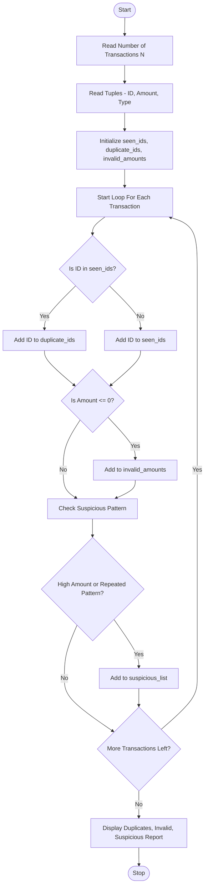

Problem Statement:
 Tuple-Based Transaction Audit: Process transaction tuples containing identifiers, amounts, and transaction types; detect duplicate identifiers, invalid amounts, and suspicious sequences.

Algorithm:
Step 1: Start
Step 2: Read number of transactions N
Step 3: Read list of transaction tuples containing (Transaction_ID, Amount, Transaction_Type)
Step 4: Initialize empty list seen_ids, duplicate_ids, invalid_amounts, suspicious_list
Step 5: For each transaction in list:
        - Extract ID, Amount, Type from tuple
        - If ID is already in seen_ids, add ID to duplicate_ids
        - Else add ID to seen_ids
        - If Amount <= 0 or Amount is not numeric, add transaction to invalid_amounts
        - Store transaction for sequence check
Step 6: For suspicious sequence detection:
        - Check if same ID appears more than 3 times consecutively
        - Check if amount exceeds threshold limit (e.g., 100000)
        - Check for rapid credit followed by debit for same ID
        - If any pattern matches, add to suspicious_list
Step 7: Display all duplicate identifiers found
Step 8: Display all invalid amounts found
Step 9: Display all suspicious sequences found
Step 10: Display final audit summary report
Step 11: Stop

Flowchart:

