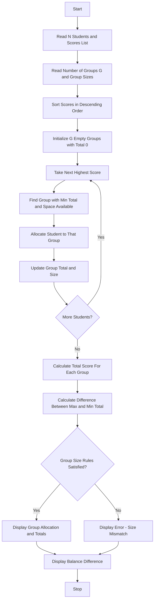

Problem Statement: Student Group Formation with Score Balancing

Arrange students using a list of scores and allocate them into groups of specified sizes while minimizing differences between group totals under defined allocation rules.

Algorithm:
1. Start
2. Read total number of students N and their scores list
3. Read number of groups G and required group sizes
4. Sort scores in descending order for balanced allocation
5. Initialize G empty groups with total score 0
6. For each student score in sorted list:
   - Find group with minimum current total and available space
   - Assign student to that group
   - Update group total and size
7. Calculate total score for each group
8. Calculate difference between max group total and min group total
9. Check if group size rules are satisfied
10. Display group allocation, group totals, and balance difference
11. Stop

Flowchart:

Sample Input:
Enter total number of students: 6
Enter scores: 90 85 80 70 75 60
Enter number of groups: 2
Enter group sizes: 3 3

Sample Output:
Sorted Scores: [90, 85, 80, 75, 70, 60]
Group 1 Allocation: [90, 75, 60] | Total Score: 225
Group 2 Allocation: [85, 80, 70] | Total Score: 235
Max Total: 235
Min Total: 225
Balance Difference: 10
Group Size Rules: Satisfied
