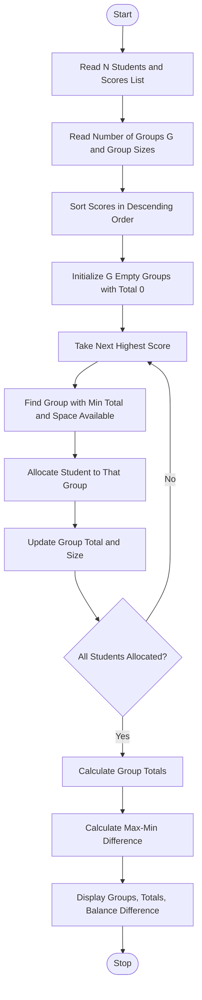

Problem Statement:
 Student Group Formation with Score Balancing: Arrange students using a list of scores and allocate them into groups of specified sizes while minimizing differences between group totals under defined allocation rules.

Algorithm:
Step 1: Start
Step 2: Read total number of students N and their scores list
Step 3: Read number of groups G and required group sizes
Step 4: Sort scores in descending order for balanced allocation
Step 5: Initialize G empty groups with total score 0
Step 6: For each student score in sorted list:
        - Find group with minimum current total and available space
        - Assign student to that group
        - Update group total and size count
Step 7: Calculate total score for each group
Step 8: Calculate difference between max group total and min group total
Step 9: Check if group size rules are satisfied
Step 10: Display group allocation, group totals, and balance difference
Step 11: Stop

Flowchart:

