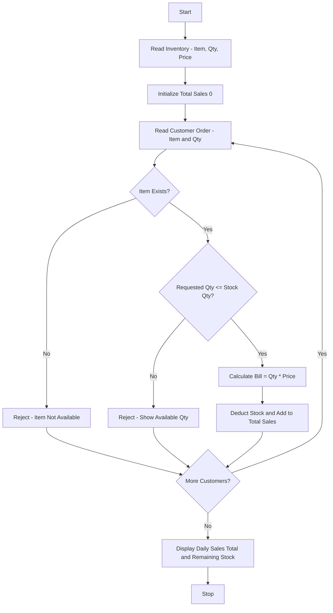

Problem Statement: Smart Canteen Order and Stock Management

Process successive customer orders, calculate bills, update available inventory, reject unavailable quantities, and summarize daily sales and remaining stock.

Algorithm:
1. Start
2. Read initial inventory with item names, quantities, and prices
3. Initialize total sales 0 and sales report list
4. Start loop for successive customer orders
5. Read customer order with item name and quantity
6. Check if item exists in inventory
7. Check if requested quantity is available
8. If quantity not available, reject order and show available stock
9. If available, calculate bill = quantity * price
10. Deduct quantity from inventory and add bill to total sales
11. Ask if more customers - if yes continue loop
12. Display daily sales total and remaining stock summary
13. Stop

Flowchart:

Sample Input:
Initial Inventory:
Item: Idli, Qty: 50, Price: 30
Item: Dosa, Qty: 30, Price: 50
Item: Tea, Qty: 100, Price: 15

Customer 1 Order: Dosa, Qty 2
Customer 2 Order: Idli, Qty 60
Customer 3 Order: Tea, Qty 2

Sample Output:
Customer 1: Order Accepted - Bill = 100 (Dosa 2 * 50)
Remaining Dosa Stock: 28
Customer 2: Order Rejected - Only 50 Idli Available
Customer 3: Order Accepted - Bill = 30 (Tea 2 * 15)
Daily Total Sales: 130
Remaining Stock:
Idli: 50
Dosa: 28
Tea: 98
