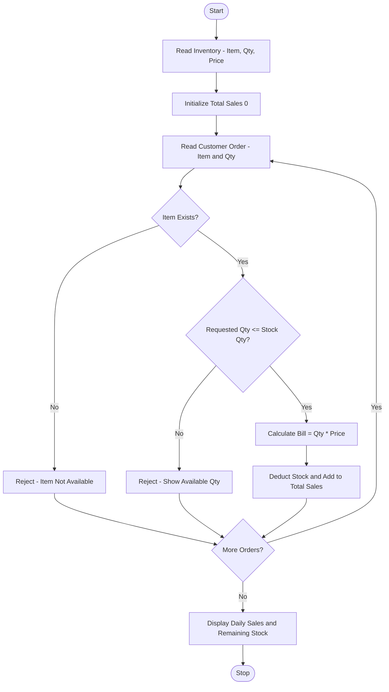

Problem Statement:
Smart Canteen Order and Stock Management: Process successive customer orders, calculate bills, update available inventory, reject unavailable quantities, and summarize daily sales and remaining stock.

Algorithm:
Step 1: Start
Step 2: Read initial inventory with item names, quantities, and prices
Step 3: Initialize total sales 0 and sales report list
Step 4: Start loop for successive customer orders
Step 5: Read customer order with item name and quantity
Step 6: Check if item exists in inventory
Step 7: Check if requested quantity is available
Step 8: If quantity not available, reject order and show available stock
Step 9: If available, calculate bill = quantity * price
Step 10: Deduct quantity from inventory and add bill to total sales
Step 11: Ask if more customers - if yes continue loop
Step 12: Display daily sales total and remaining stock summary
Step 13: Stop

Flowchart:

