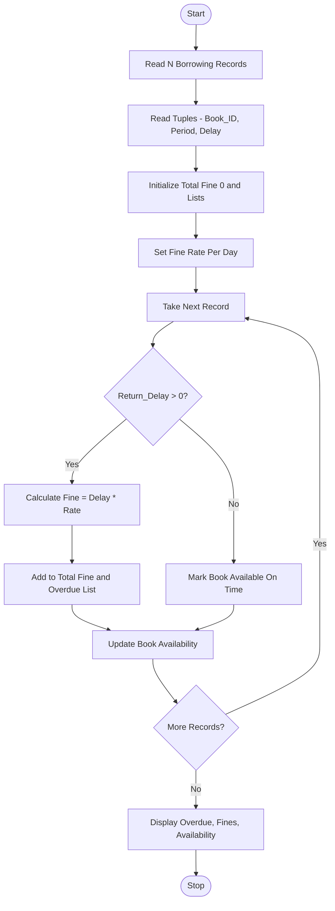

Problem Statement:
Library Borrowing and Fine Reconciliation: Analyse tuples representing book identifiers, borrowing periods, and return delays; calculate fines, identify overdue records, and reconcile book availability.

Algorithm:
Step 1: Start
Step 2: Read total number of borrowing records N
Step 3: Read tuples containing Book_ID, Borrowing_Period, Return_Delay
Step 4: Initialize total fine 0, overdue list, available books list
Step 5: Define fine rate per day
Step 6: For each tuple:
        - Calculate overdue days = Return_Delay
        - If Return_Delay > 0, calculate fine = delay * fine_rate
        - Add fine to total fine
        - Add record to overdue list
        - Mark book as returned or not available
        - Else mark book as available on time
Step 7: Identify all overdue records
Step 8: Calculate fine for each overdue book
Step 9: Reconcile book availability - update inventory
Step 10: Display overdue records, fines, total fine, and available books
Step 11: Stop

Flowchart:

