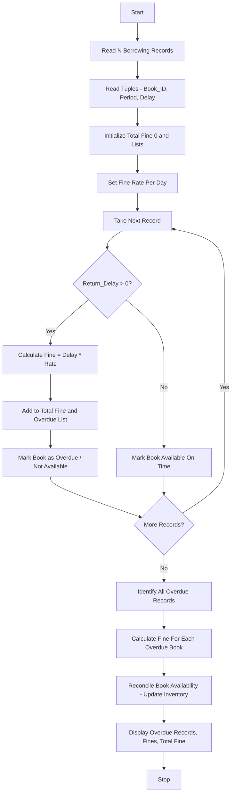

Problem Statement: Library Borrowing and Fine Reconciliation

Analyse tuples representing book identifiers, borrowing periods, and return delays; calculate fines, identify overdue records, and reconcile book availability.

Algorithm:
1. Start
2. Read total number of borrowing records N
3. Read tuples containing Book_ID, Borrowing_Period, Return_Delay
4. Initialize total fine 0, overdue list, available books list
5. Define fine rate per day
6. For each tuple:
   - Calculate overdue days = Return_Delay
   - If Return_Delay > 0, calculate fine = delay * fine_rate
   - Add fine to total fine
   - Add record to overdue list
   - Mark book as returned or not available
   - Else mark book as available on time
7. Identify all overdue records
8. Calculate fine for each overdue book
9. Reconcile book availability - update inventory
10. Display overdue records, fines, total fine, and available books
11. Stop

Flowchart:

Sample Input:
Enter total borrowing records: 4
Record 1: Book_ID=101, Period=7, Delay=2
Record 2: Book_ID=102, Period=5, Delay=0
Record 3: Book_ID=103, Period=10, Delay=5
Record 4: Book_ID=104, Period=3, Delay=0
Fine Rate Per Day: 10

Sample Output:
Overdue Records: [101, 103]
Book 101: Delay 2 days, Fine = 20
Book 103: Delay 5 days, Fine = 50
Total Fine: 70
Available Books On Time: [102, 104]
Reconciled Inventory:
Available: 102, 104
Not Available / Overdue: 101, 103
