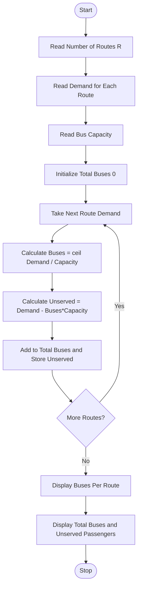

Problem Statement:
Campus Transport Allocation: Determine the number of buses needed for several routes, account for bus capacities and passenger demand, and identify unserved passengers.

Algorithm:
Step 1: Start
Step 2: Read number of routes R
Step 3: Read passenger demand for each route
Step 4: Read bus capacity
Step 5: Initialize total buses needed 0 and unserved list
Step 6: For each route:
        - Calculate buses needed = ceil(demand / capacity)
        - Calculate served passengers = buses needed * capacity
        - Calculate unserved = max(0, demand - served)
        - If limited buses available, calculate actual unserved
Step 7: Sum total buses needed for all routes
Step 8: Identify routes with unserved passengers
Step 9: Display buses per route, total buses, and unserved passengers
Step 10: Stop

Flowchart:

