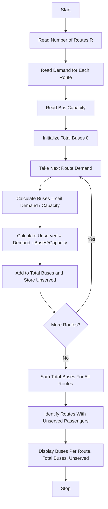

Problem Statement: Campus Transport Allocation

Determine the number of buses needed for several routes, account for bus capacities and passenger demand, and identify unserved passengers.

Algorithm:
1. Start
2. Read number of routes R
3. Read passenger demand for each route
4. Read bus capacity
5. Initialize total buses needed 0 and unserved list
6. For each route:
   - Calculate buses needed = ceil(demand / capacity)
   - Calculate served passengers = buses needed * capacity
   - Calculate unserved = max(0, demand - served)
   - If limited buses available, calculate actual unserved
7. Sum total buses needed for all routes
8. Identify routes with unserved passengers
9. Display buses per route, total buses, and unserved passengers
10. Stop

Flowchart:

Sample Input:
Enter number of routes: 3
Enter passenger demand: Route1=45, Route2=70, Route3=20
Enter bus capacity: 30
Available buses: Unlimited (or Limited = 3)

Sample Output:
Route 1: Demand 45, Buses Needed = 2, Served = 60, Unserved = 0
Route 2: Demand 70, Buses Needed = 3, Served = 90, Unserved = 0
Route 3: Demand 20, Buses Needed = 1, Served = 30, Unserved = 0
Total Buses Needed: 6
Routes with Unserved: None (if unlimited buses)
If Limited Buses = 3: Unserved passengers calculated accordingly
