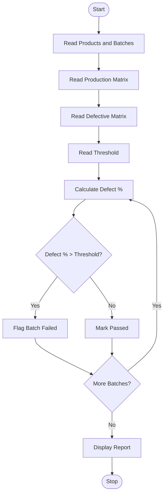

Problem Statement:
 Manufacturing Quality Control Matrix: Analyse production quantities and defective units across products and batches, calculate defect percentages, and identify batches exceeding quality thresholds.

Algorithm:
Step 1: Start
Step 2: Read number of products and batches
Step 3: Read production matrix quantity for each product and batch
Step 4: Read defective matrix for each product and batch
Step 5: Read quality threshold percentage
Step 6: For each product and batch calculate defect percentage = defective / production * 100
Step 7: Identify batches where defect percentage > threshold
Step 8: Calculate total production and total defective
Step 9: Display matrices and flagged batches
Step 10: Stop

Flowchart:

