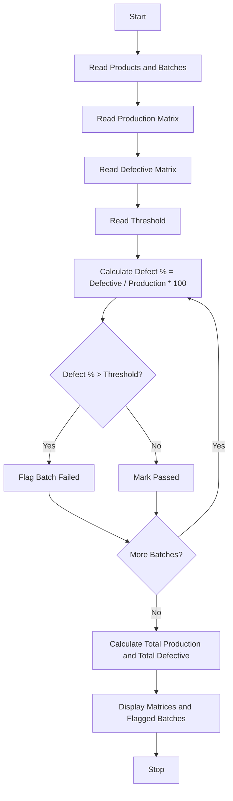

Problem Statement: Manufacturing Quality Control Matrix

Analyse production quantities and defective units across products and batches, calculate defect percentages, and identify batches exceeding quality thresholds.

Algorithm:
1. Start
2. Read number of products and batches
3. Read production matrix quantity for each product and batch
4. Read defective matrix for each product and batch
5. Read quality threshold percentage
6. For each product and batch calculate defect percentage = defective / production * 100
7. Identify batches where defect percentage > threshold
8. Calculate total production and total defective
9. Display matrices and flagged batches
10. Stop

Flowchart:

Sample Input:
Enter number of products: 2
Enter number of batches: 3
Production Matrix:
Product1: 100 200 150
Product2: 300 250 100
Defective Matrix:
Product1: 5 10 20
Product2: 6 30 2
Quality Threshold: 5%

Sample Output:
Defect Percentage Matrix:
Product1: 5% 5% 13.33% - Flagged: Batch3
Product2: 2% 12% 2% - Flagged: Batch2
Total Production: 1100
Total Defective: 73
Overall Defect %: 6.63%
Flagged Batches: Product1-Batch3 (13.33%), Product2-Batch2 (12%)
 
