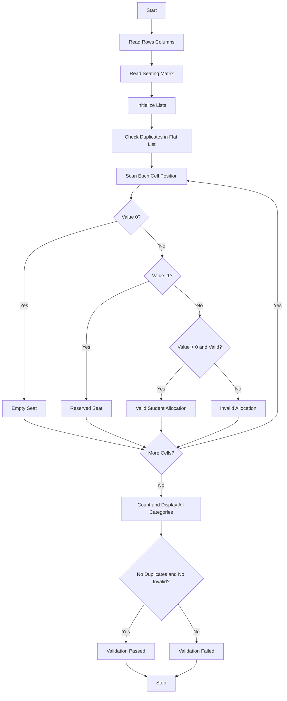

Problem Statement: Nested List Examination Seating Validation

Validate a complete seating matrix for duplicate roll numbers, reserved positions, empty seats, and invalid student allocations.

Algorithm:
1. Start
2. Read rows and columns
3. Read seating matrix with roll numbers, 0 empty, -1 reserved
4. Initialize empty, reserved, invalid lists
5. Check duplicates in flat list
6. Scan each cell and categorize empty, reserved, invalid, valid
7. Count and display all categories
8. Validate no duplicates and no invalid allocations
9. Display final validation result
10. Stop

Flowchart:

Sample Input:
Enter rows: 2
