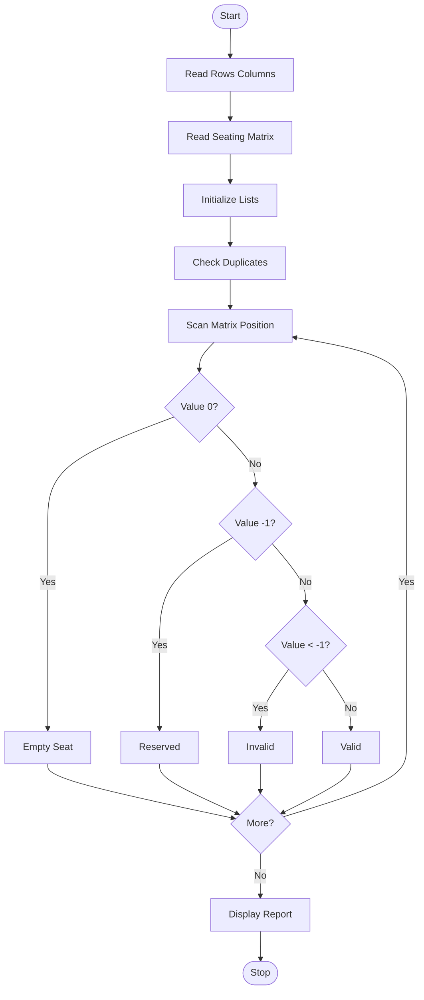

Problem Statement:
Nested List Examination Seating Validation: Validate a complete seating matrix for duplicate roll numbers, reserved positions, empty seats, and invalid student allocations.

Algorithm:
Step 1: Start
Step 2: Read rows and columns
Step 3: Read seating matrix with roll numbers, 0 empty, -1 reserved
Step 4: Initialize empty, reserved, invalid lists
Step 5: Check duplicates in flat list
Step 6: Scan each cell and categorize empty, reserved, invalid, valid
Step 7: Count and display all categories
Step 8: Validate no duplicates and no invalid allocations
Step 9: Display final validation result
Step 10: Stop

Flowchart:

